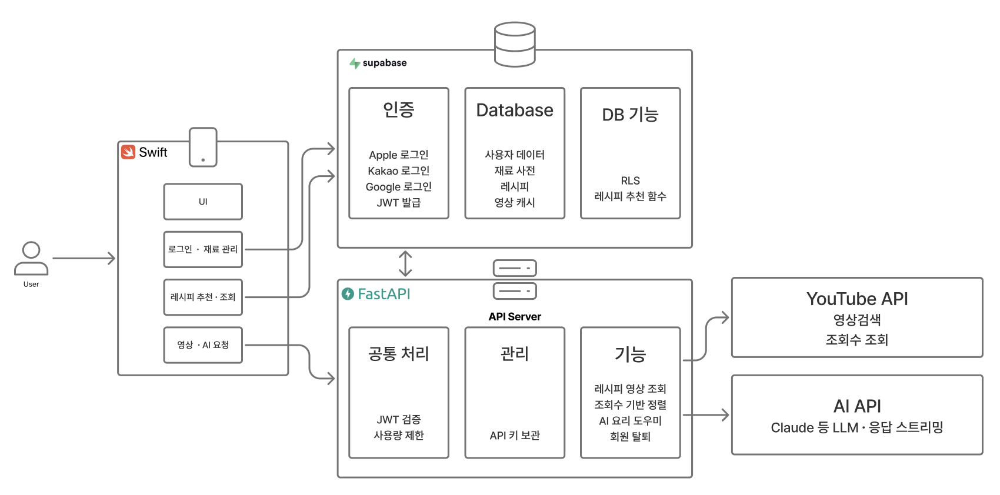
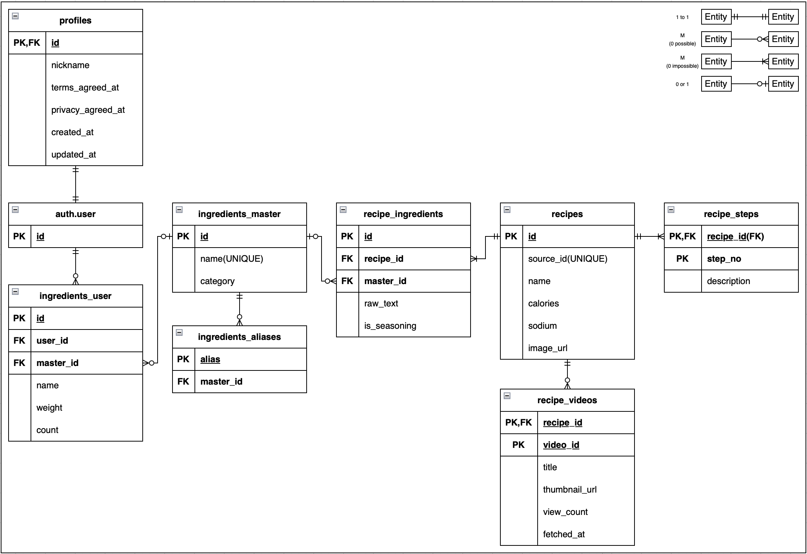

# FridgeChef Project

### Project Description

#### This project is an iOS application that searches for cookable dishes and recommends recipes based on the ingredients a user has added to their refrigerator.
---
### Directory Structure
```
FridgeChef(Root)
├───FridgeChef (실제 코드 파일)
│   ├───FridgeChefApp.swift (앱 시작점 == main)
│   └───ContentView.swift (첫 화면 UI)
├───FridgeChef.xcodeproj (프로젝트 설정 파일)
├───FridgeChefTests (단위 테스트)  
├───FridgeChefUITests (UI 테스트)
├───FridgeChef_ERD.png (ERD 다이어그램)
├───FridgeChef_System_architecture.png (시스템 구성도)
└───README.md
```
---
### System Architecture


---
### Entity Relationship Diagram


---
### Database RLS Policy
| Table | Policy Name | Command | Target | USING | WITH CHECK |
|:---:|:---:|:---:|:---:|:---:|:---:|
|profiles|Select own's profiles|SELECT|Authenticated|select auth.uid() = id|X|
|profiles|Update own's profiles|UPDATE|Authenticated|select auth.uid() = id|select auth.uid() = id|
|ingredients_user|Select own's ingredients|SELECT|Authenticated|select auth.uid() = id|X|
|ingredients_user|Insert own's ingredients|INSERT|Authenticated|X|select auth.uid() = id|
|ingredients_user|Update own's ingredients|UPDATE|Authenticated|select auth.uid() = id|select auth.uid() = id|
|ingredients_user|Delete own's ingredients|DELETE|Authenticated|select auth.uid() = id|X|
|ingredients_master|Select for anyone|SELECT|Anon, Authenticated|true|X|
|ingredients_aliases|Select for anyone|SELECT|Anon, Authenticated|true|X|
|recipe|Select for anyone|SELECT|Anon, Authenticated|true|X|
|recipe_ingredients|Select for anyone|SELECT|Anon, Authenticated|true|X|
recipe_steps|Select for anyone|SELECT|Anon, Authenticated|true|X|
recipe_videos|Select for anyone|SELECT|Anon, Authenticated|true|X|

__(select auth.uid() = id)를 통해 타인에 의해 데이터가 수정되지 않도록 제한__<br>
__USING과 WITH CHECK는 이미 있는 행에 대한 접근과 새로 쓰려는 행에 대한 검증에 해당__<br>
__profiles 테이블에 INSERT와 DELETE는 가입 트리거로 관리자가 튜플을 생성하고 회원탈퇴 시 FK의 CASCADE 정책에 의해 지워지기 때문에 필요 없음__<br>
